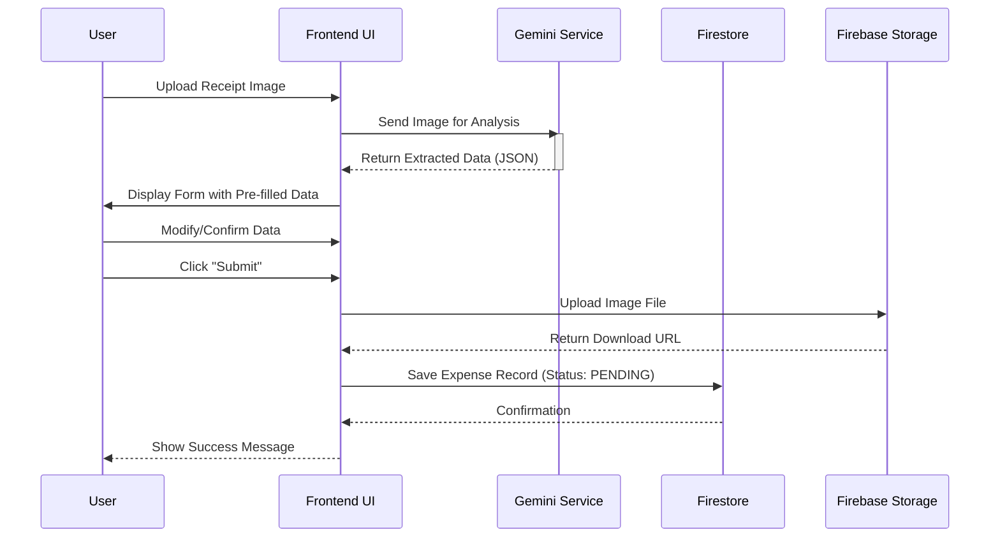
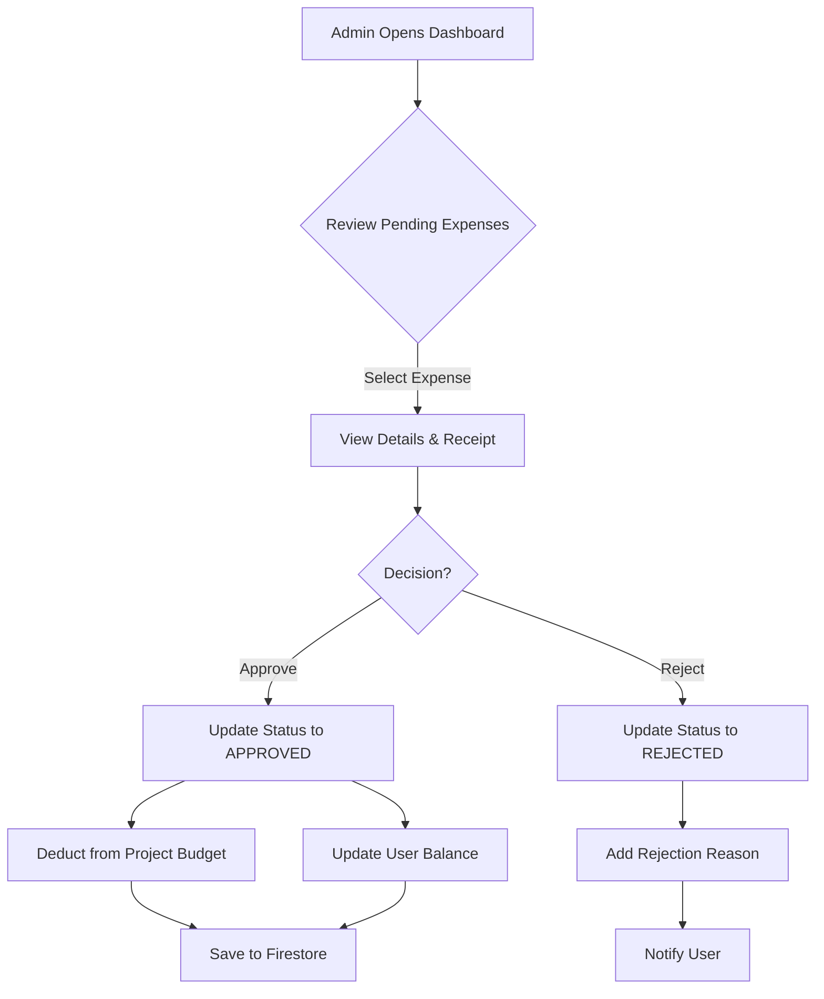

# SPI Smart Expense

A modern, intelligent expense tracking and management application designed to streamline the improved workflow between professionals submitting expenses and administrators managing project budgets.

This application leverages **Artificial Intelligence (Google Gemini)** to automate data entry from receipts, reducing manual errors and saving time.

---

## 🧱 v3 foundations — Expense Buddy (Ola 0, 2026-10-24)

SPI Smart Expense is becoming the first tenant of **Expense Buddy**, a multi-client expense-report platform where each client runs its own Firebase project from this single codebase.

- **Tenant config**: `tenants/<id>.json` (branding, locale, auth, modules) injected at build time via `VITE_TENANT`; `index.html` title/description/theme colour and the Tailwind `brand` palette (CSS variables) follow the tenant.
- **Env validation at boot**: `src/lib/env.ts` + `EnvError` list exactly which `VITE_*` variables are missing.
- **TypeScript (gradual)**: `tsconfig.json` with `allowJs`, typed Firestore models in `src/types/models.ts`, new libs in TS.
- **Tests**: Vitest + Testing Library (`npm test -- --run`), first suites on permissions, currency formatting, tenant and env.
- **Cloud Functions workspace**: `functions/` (TypeScript, Node 22) with a `healthcheck` callable, wired in `firebase.json`.
- **Firestore indexes versioned**: `firestore.indexes.json` (notifications, user expenses).
- **CI**: GitHub Actions runs lint, typecheck, tests and builds for the `spi` and `demo` tenants.
- **Docs**: `docs/implementation-plan.md` (Olas 0–9), `docs/adr/`, `docs/backlog.md`, `docs/technical-debt.md`.

### Ola 1 — Installable PWA (2026-10-25)

- **"Instalar app" always visible**: `src/lib/install.ts` captures `beforeinstallprompt` before React mounts; `InstallButton` lives in the header, the sidebar and the login page and only disappears once the app is installed. Android/desktop get the native prompt, iOS gets Safari's two steps.
- **Service worker with controlled updates**: `vite-plugin-pwa` (`registerType: 'prompt'`) precaches the app shell; `UpdateToast` offers "Recargar" when a new build is waiting instead of swapping bundles silently.
- **Per-tenant manifest and icons**: manifest generated from `tenants/<id>.json`; square 192/512/maskable/apple-touch icons in `public/icons/<id>/` (`npm run icons`, Python + Pillow).
- **Offline reads**: Firestore `persistentLocalCache` keeps already-loaded data available without network.

### Ola 2 — Secure backend (2026-10-25)

- **Money is written server-side only**: the `onExpenseWritten` Cloud Function derives `users.balance` and `projects.expenses` from every expense create/edit/delete/status change (idempotent via `aggregateLedger`). No page writes balances anymore.
- **Approvals through `reviewExpense`**: approve / reject / reopen run in one server transaction that authorises by claims, stamps the reviewer, appends the audit movement and notifies the submitter.
- **Gemini behind `extractReceipt`, on Vertex AI**: Functions call Gemini through Vertex AI with IAM (`@google/genai`), so there is no API key anywhere; model fallback, retries and daily rate limits (per user and per tenant) live on the server. The web bundle no longer contains a key nor the Gemini SDK.
- **Custom claims**: `onUserWritten` mirrors role/permissions into the ID token; `firestore.rules` and `storage.rules` authorise from claims with field-level schema validation (15 rules tests, `npm run test:rules`). Self-registration is always `professional`.

### Ola 3 — Superadmin, users and settings (2026-10-25)

- **Superadmin role** above admin: sees Configuración → Usuarios and Ajustes; admins keep approving as before.
- **`/admin/users`** replaces the old seeder: invite by email (account created server-side, the person sets a password from Firebase's native email), change role (including promoting superadmins, never demoting oneself, always one superadmin left), assign a manager, activate/deactivate (an open session is signed out within seconds), resend invitation / password reset, delete users without financial history.
- **`/admin/settings`**: PIN toggle (enforced from Ola 4), module switches that hide sections for everyone instantly, daily AI reading limits. Stored in `settings/tenant`, defaults from `tenants/<id>.json`.
- **Scripts**: `npm run superadmin:bootstrap` (first superadmin) and `npm run migrate:003` (user fields backfill).

### Ola 6 — Offline, push and share (2026-10-25)

- **Submit without signal**: expenses (with photos) are kept on the device and sent automatically when the connection returns or the app opens; header pill "Sin conexión / N sin enviar", and a retry/discard list in Mi Espacio. Fixed document ids make retries duplicate-free.
- **Share a photo to the app** (Android, installed PWA): the OS share sheet opens Nueva Rendición with the image loaded.
- **Push notifications** on opt-in per device (Mi Espacio): every in-app notification also arrives as a system notification; tapping it opens the right screen. Needs the project's Web Push key (`VITE_FCM_VAPID_KEY`).

### Ola 5 — Approval workflows, audit timeline, email (2026-10-25)

- **Approval policy per tenant** in Ajustes: *Simple* (today's single step, SPI's default) or *Por niveles* (submitter's manager → finance), optional second finance signature above an amount, auto-approval below an amount, temporary delegation, and opt-in reminders for stale expenses.
- **Mis aprobaciones** for managers of any role, with optional comment; admins see level badges in Aprobaciones.
- **Audit timeline** in every expense detail: who approved/rejected/edited, comments, overrides and automatic approvals.
- **Email** via Brevo (approved, rejected, needs approval, stale digest) through an outbox, branded per tenant; users can opt out in Mi Espacio. Activated per tenant once the Brevo key and sender exist.

### Ola 4 — Per-action PIN (2026-10-25)

- **4-digit personal PIN**, verified only on the server (scrypt, lockout after 5 failures, disabled after 10, weak PINs rejected), with a versioned responsibility statement accepted at creation.
- **Superadmin-controlled**: off by default; enabled in Ajustes with per-action switches (approve, reject, delete others' expenses, export, user management, settings) and an amount threshold for approvals.
- **Seamless UX**: a single global prompt appears only when the server asks, the PIN is remembered for 2 minutes, bulk approvals ask once; people create or change it in Mi Espacio → Seguridad; superadmins reset PINs from Usuarios and review the PIN audit log in Ajustes.
- **App Check** (reCAPTCHA Enterprise) wired behind `VITE_RECAPTCHA_SITE_KEY`, monitor mode first.
- Deploy order and cutover: `docs/runbooks/deploy-ola-2.md`.

---

## 🆕 Recent Features (v2.0)

- **Multi-currency totals**: All dashboard views now separate COP and USD expense totals, displayed as stacked currency blocks.
- **Automatic TRM capture**: When submitting or editing a USD expense, the app fetches the live USD→COP exchange rate (TRM) from `open.er-api.com` and stores `trm`, `amountCOP`, and `trmSource` on the expense document.
- **Receipt image viewer**: Full-screen lightbox with tab switching between Recibo and Voucher; PDF files show an "Abrir PDF" fallback link.
- **Expense editing**: Admins can edit any expense via the `EditExpenseModal` (amount, currency, description, TRM recalculation).
- **Tarjeta / empresa**: Card last-4 and card company captured at submission, visible in approvals table and expense details.
- **Assistant role**: New `assistant` Firestore role that can submit expenses on behalf of others.
- **Reports page** (`/admin/reports`): Advanced filters (user, cost center, date range, currency, status, card company) with CSV export, Excel export (with auto-column widths and summary rows), and ZIP download of all receipt images.
- **Optimized bundle**: Vite `manualChunks` splits the build into `vendor-firebase`, `vendor-react`, `vendor-ui`, and `vendor-utils` for faster page loads.

---

## 🚀 Key Features

### 🤖 AI-Powered Expense Entry

- **Automated Parsing**: Upload a photo of a receipt or invoice, and the system automatically extracts the date, merchant, amount, tax ID, and more using **Google Gemini**.
- **Smart Categorization**: The AI suggests appropriate categories for expenses based on the context of the receipt.

### 👥 Role-Based Access Control

- **Professional Role**:
  - Scan and submit expenses.
  - View personal balance and reimbursement status.
  - Track expense history.
- **Admin Role**:
  - **Dashboard**: Overview of total project budgets and pending approvals.
  - **Project Management**: Create and manage projects, assign users, and set budgets.
  - **Approval Workflow**: Review, approve, or reject submitted expenses.
  - **User Management**: Manage user roles and balances.
  - **Seeding**: Tools for initial data population.

### 💰 Financial Management

- **Budget Tracking**: Real-time tracking of project budget consumption.
- **Balance Sheet**: Automated calculation of user balances (Advances vs. Expenses).
- **Multi-Currency Support**: Handles various currencies with normalization (e.g., COP, USD).

---

## 🛠 Technology Stack

- **Frontend Framework**: [React](https://react.dev/) (v19)
- **Build Tool**: [Vite](https://vitejs.dev/)
- **Styling**: [Tailwind CSS](https://tailwindcss.com/)
- **Backend / Database**: [Firebase](https://firebase.google.com/)
  - **Authentication**: Secure user login and role management.
  - **Firestore**: NoSQL database for real-time data syncing.
  - **Storage**: Secure storage for receipt images.
- **Artificial Intelligence**: [Google Gemini API](https://ai.google.dev/) (via `google-generative-ai` SDK)
- **Routing**: [React Router](https://reactrouter.com/) (v7)

---

## 🏗 Architecture Overview

The application follows a serverless architecture pattern, relying on Firebase for backend services and Google Gemini for cognitive tasks.

```mermaid
graph TD
    User[User (Web Browser)]

    subgraph "Frontend Client"
        Router[React Router]
        AuthCtx[Auth Context]
        Pages[UI Pages]
        Services[Service Components]
    end

    subgraph "External Services"
        FirebaseAuth[Firebase Auth]
        Firestore[Firestore DB]
        Storage[Firebase Storage]
        Gemini[Google Gemini API]
    end

    User -->|Interacts| Pages
    Pages -->|Navigates| Router
    Pages -->|Uses| AuthCtx

    AuthCtx -->|Authenticates| FirebaseAuth

    Pages -->|Reads/Writes Data| Services
    Services -->|CRUD Operations| Firestore
    Services -->|Upload Images| Storage

    Services -->|Analyze Image| Gemini
```

---

## 🔄 Functional Logic Workflows

### 1. Expense Submission Flow (Professional)

This workflow details how a user submits an expense using AI assistance.



### 2. Expense Approval Flow (Admin)

How an administrator reviews and approves expenses, affecting project budgets and user balances.



---

## 💻 Getting Started

### Prerequisites

- **Node.js** (v18 or higher)
- **npm** or **yarn**
- **Firebase Account**: You need a Firebase project with Auth, Firestore, and Storage enabled.
- **Google AI Studio Key**: An API key for Google Gemini.

### Installation

1.  **Clone the repository:**

    ```bash
    git clone https://github.com/your-username/spi-smart-expense.git
    cd spi-smart-expense
    ```

2.  **Install dependencies:**

    ```bash
    npm install
    # or
    yarn install
    ```

3.  **Environment Configuration:**
    Create a `.env` file in the root directory based on `.env.example`. Fill in your specific keys:

    ```env
    # Firebase Configuration
    VITE_FIREBASE_API_KEY=your_api_key
    VITE_FIREBASE_AUTH_DOMAIN=your_project.firebaseapp.com
    VITE_FIREBASE_PROJECT_ID=your_project_id
    VITE_FIREBASE_STORAGE_BUCKET=your_project.appspot.com
    VITE_FIREBASE_MESSAGING_SENDER_ID=your_sender_id
    VITE_FIREBASE_APP_ID=your_app_id

    # Google Gemini AI

    # Tenant to build (tenants/<id>.json). Defaults to spi.
    VITE_TENANT=spi
    ```

4.  **Run the Development Server:**
    ```bash
    npm run dev
    ```
    The application will typically start at `http://localhost:5173`.

5.  **Test safely with the Emulator Suite** (recommended for any manual testing — it never touches a client's Firebase project):
    ```bash
    npm run emulators   # terminal 1
    npm run seed:emu    # terminal 2 — creates test accounts and sample data
    npm run dev:emu     # terminal 3
    ```
    See `docs/runbooks/emulators.md` for the test accounts and details.

---

## 📂 Project Structure

```
spi-smart-expense/
├── src/
│   ├── components/      # Reusable UI components (Buttons, Layouts)
│   ├── context/         # React Contexts (AuthContext)
│   ├── lib/             # External service wrappers (firebase.js, gemini.js)
│   ├── pages/           # Application views/routes
│   │   ├── Admin*.jsx   # Admin-specific pages
│   │   ├── User*.jsx    # User-specific pages
│   │   └── Login.jsx    # Authentication entry point
│   ├── utils/           # Helper functions
│   ├── App.jsx          # Main Router configuration
│   └── main.jsx         # Entry point
│   ├── types/           # Firestore document types (models.ts)
│   └── lib/tenant.ts    # Tenant config loader + theming
├── tenants/             # One JSON per client (spi.json, demo.json)
├── functions/           # Cloud Functions (TypeScript, Node 22)
├── docs/                # Implementation plan, ADRs, backlog, technical debt
├── scripts/             # Admin SDK scripts and data migrations
├── public/              # Static assets
└── ...config files      # (vite.config.js, tailwind.config.js, tsconfig.json, etc.)
```

---

## 🚀 Deployment

The project is configured for deployment on **Firebase Hosting**.

1.  **Build the project for a tenant:**

    ```bash
    npm run build            # spi (default)
    npm run build:demo       # Expense Buddy demo
    ```

2.  **Deploy to that tenant's Firebase project:**
    ```bash
    firebase deploy --project <tenant-project-id>
    ```

    Hosting, Firestore rules and indexes, Storage rules and Cloud Functions deploy together. Deploy indexes before shipping any query that depends on them.

---

## 📄 License

This project is proprietary software. All rights reserved.
